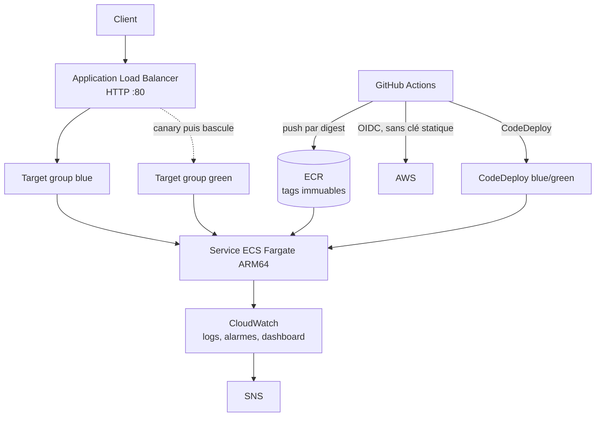

# aws-ecs-bluegreen

Service Node.js minimaliste déployé sur **AWS ECS Fargate (ARM64)** derrière un
Application Load Balancer, avec des déploiements **blue/green CodeDeploy** et
une chaîne CI/CD complète sur GitHub Actions. L'infrastructure est entièrement
décrite dans `infra/`.

## Sommaire

- [Architecture](#architecture)
- [Points d'entrée](#points-dentrée)
- [Développement local](#développement-local)
- [Chaîne CI/CD](#chaîne-cicd)
- [Environnements](#environnements)
- [Mise en route](#mise-en-route)
- [Structure du dépôt](#structure-du-dépôt)
- [Documentation](#documentation)
- [Limites connues](#limites-connues)

## Architecture



- Compte AWS : `682227955413`, région `eu-north-1`.
- VPC dédié, deux sous-réseaux publics (ALB) et deux privés (tâches), un NAT
  gateway.
- ECS Fargate ARM64, autoscaling sur le CPU.
- ECR avec scan à l'envoi, tags immuables, cycle de vie 10 images taguées et
  7 jours pour les images non taguées.
- Deux target groups (blue/green) pilotés par CodeDeploy.
- CloudWatch : logs, cinq alarmes, dashboard, sujet SNS.
- Cinq rôles IAM par environnement : exécution ECS, tâche ECS, service
  CodeDeploy, déploiement GitHub Actions et Terraform GitHub Actions.

## Points d'entrée

| Méthode | Chemin | Réponse |
| --- | --- | --- |
| `GET`, `HEAD` | `/` | `Hello from ECS on Fargate!` |
| `GET`, `HEAD` | `/health` | `{"status":"ok","version":"...","uptimeSeconds":...}` |
| `GET`, `HEAD` | `/ready` | `{"status":"ready","version":"...","uptimeSeconds":...}` |
| autre | chemin inconnu | `404` JSON |
| autre | méthode non lue | `405` JSON |

Chaque réponse contient un en-tête `x-request-id`, repris de la requête entrante
s'il existe. Les logs sont émis en JSON sur stdout et collectés par CloudWatch.

## Développement local

Prérequis : Node.js 24 LTS et npm.

```bash
npm ci
npm run lint
npm test

npm start
# dans un autre terminal
curl --silent http://localhost:8080/health
```

L'image conteneur peut être construite localement :

```bash
docker build -t aws-ecs-bluegreen:local .
docker run --rm -p 8080:8080 aws-ecs-bluegreen:local
```

## Chaîne CI/CD

| Workflow | Déclencheur | Rôle |
| --- | --- | --- |
| `ci.yml` | pull request vers `main`, ou appelé par `deploy.yml` | lint, tests, audit, secrets, Trivy, Terraform fmt/validate/plan |
| `deploy.yml` | push sur `main`, push d'un tag `v*`, ou manuel | orchestration : CI, apply Terraform dev, déploiement dev, release prod |
| `deploy-env.yml` | workflow réutilisable | build ARM64, scan image, SBOM, attestation, ECR, CodeDeploy, smoke test |
| `infra.yml` | appelé par `deploy.yml`, ou manuel | `terraform plan`/`apply` pour `dev` ou `prod` |
| `rollback.yml` | manuel | redéploiement d'une révision de tâche existante |

Sur une pull request, les contrôles bloquants sont : actionlint, hadolint,
ESLint, tests Node, `npm audit` (dépendances de production), gitleaks, Trivy
(vulnérabilités et secrets), `terraform fmt`, `terraform validate` (bootstrap,
`dev` et `prod`) et le plan Terraform de `dev`.

Sur `main`, chaque fusion lance le déploiement de `dev`. La production est
déployée uniquement lors du push d'un tag `vX.Y.Z`, après approbation manuelle
de l'environnement GitHub `prod`.

## Environnements

| | `dev` | `prod` |
| --- | --- | --- |
| Tâches (désirées / min / max) | 1 / 1 / 2 | 2 / 2 / 6 |
| CPU / mémoire | 256 / 512 | 256 / 512 |
| Déploiement CodeDeploy | all-at-once | canary 10 %, 5 minutes |
| Rétention des logs | 30 jours | 90 jours |
| Protection contre la suppression de l'ALB | non | oui |
| Approbation GitHub | non | oui |
| ECR | `aws-ecs-bluegreen-dev` | `aws-ecs-bluegreen-prod` |

Les deux environnements vivent dans le même compte AWS. L'isolation repose sur
des rôles IAM et des environnements GitHub distincts.

## Mise en route

L'ordre importe : le backend Terraform et le fournisseur OIDC doivent exister
avant les environnements, et les variables GitHub avant le premier déploiement.
Les étapes 1 à 3 se font avant la fusion de la pull request : sur `main`, le push
déclenche le premier déploiement. Un lancement manuel de `deploy.yml` n'est
accepté que depuis `main`.

```bash
# 1. Backend S3 et fournisseur OIDC GitHub (une seule fois)
cd infra/bootstrap
terraform init
terraform apply

# 2. Environnement dev
cd ../live/dev
terraform init
terraform apply -var-file=dev.tfvars

# 3. Variables et environnements GitHub pour dev
cd ../../..
AWS_PROFILE=dev-admin ./scripts/setup-github-env.sh dev

# 4. Fusionner la pull request, puis relancer si besoin
git switch main
git pull
gh workflow run deploy.yml --ref main
```

Pour la production, appliquer d'abord l'infrastructure, puis configurer GitHub,
puis créer un tag de release :

```bash
cd infra/live/prod
terraform init
terraform apply -var-file=prod.tfvars
cd ../../..

AWS_PROFILE=dev-admin ./scripts/setup-github-env.sh prod

git switch main
git pull
git tag -a v2.0.0 -m "v2.0.0"
git push origin v2.0.0
gh release create v2.0.0 --generate-notes --verify-tag
```

Le push du tag déclenche `deploy.yml`, qui exécute la CI, vérifie que le tag est
semver et ancêtre de `main`, puis démarre le job `Deploy prod`. Ce job reste en
attente jusqu'à l'approbation de l'environnement `prod` dans l'onglet
**Actions**. Après approbation, l'image `v2.0.0` est construite, scannée, puis
déployée en canary 10 % pendant 5 minutes.

Après la fusion de la pull request d'infrastructure, activer la protection de
`main` :

```bash
./scripts/protect-main.sh
```

Le dépôt public autorise la protection de branche, le ruleset `release-tags` et
le reviewer obligatoire de l'environnement `prod`. Un push direct sur `main` ou
un tag `v*` modifié est refusé.

## Structure du dépôt

```text
.
├── .github/workflows/     # CI, déploiement, infrastructure, rollback
├── docs/ci-cd.md          # fonctionnement détaillé, release, rollback
├── infra/
│   ├── bootstrap/         # bucket de state S3 et provider OIDC GitHub
│   ├── modules/app/       # VPC, ALB, ECR, ECS, CodeDeploy, IAM, monitoring
│   └── live/dev|prod/     # paramétrage et backend de chaque environnement
├── scripts/
│   ├── setup-github-env.sh
│   ├── protect-main.sh
│   └── smoke-test.sh
├── test/                  # tests node:test
├── server.js
└── Dockerfile
```

## Documentation

- [`docs/ci-cd.md`](docs/ci-cd.md) : workflows, rôles OIDC, variables GitHub,
  procédure de release, rollback et dépannage.
- [`infra/README.md`](infra/README.md) : Terraform, bootstrap, état, variables,
  exploitation et destruction.

## Limites connues

- HTTP uniquement, sans TLS, nom de domaine personnalisé ni WAF.
- Un seul NAT gateway pour les deux zones de disponibilité.
- L'infrastructure de `prod` n'est pas appliquée automatiquement lors d'un tag :
  elle passe par le workflow `Infrastructure` avec un lancement manuel.
- Les notifications email des alarmes ne sont pas encore configurées
  (`alarm_emails = []`). Les alarmes restent actives pour CodeDeploy.
- Les actions GitHub sont épinglées par version majeure, pas par empreinte de
  commit.
- Le state du bootstrap est local et doit être sauvegardé séparément.
