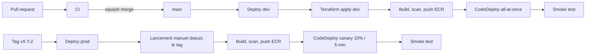

# CI/CD

Ce document décrit le fonctionnement de la chaîne CI/CD, les rôles AWS, les
variables GitHub, les procédures de release et de rollback, et les points de
dépannage.

## Vue d'ensemble



Principes :

- aucun secret AWS statique : GitHub Actions obtient des identifiants
  temporaires via OpenID Connect ;
- une image construite une seule fois par déploiement, poussée avec un tag
  immuable, puis déployée par digest ;
- la production n'est déployée que depuis un tag semver, par un lancement
  manuel depuis ce tag ;
- CodeDeploy bascule le trafic entre deux target groups, via un listener de
  production et un listener de test, et peut annuler un déploiement sur alarme ;
- l'infrastructure est décrite dans Terraform et contrôlée par le même pipeline.

## Workflows et déclencheurs

| Workflow | Déclencheur | Rôle assumé | Rôle du workflow |
| --- | --- | --- | --- |
| `ci.yml` | pull request vers `main` ; appelé par `deploy.yml` | `TERRAFORM_ROLE_ARN` pour le plan dev uniquement | contrôles de qualité et de sécurité |
| `deploy.yml` | push sur `main`, push d'un tag `v*`, `workflow_dispatch` | aucun directement | orchestre CI, infrastructure dev et déploiements |
| `deploy-env.yml` | workflow réutilisable | `AWS_ROLE_ARN` de l'environnement | build, scan, SBOM, attestation, ECR, CodeDeploy, smoke test |
| `infra.yml` | appelé par `deploy.yml` ; `workflow_dispatch` | `TERRAFORM_ROLE_ARN` de l'environnement | `terraform plan`, puis `apply` si demandé |
| `rollback.yml` | `workflow_dispatch` | `AWS_ROLE_ARN` de l'environnement | redéploiement d'une révision de tâche existante |

### Sur une pull request

`ci.yml` exécute les contrôles. Le job `Terraform plan (dev)` assume le rôle
Terraform de `dev` via l'environnement GitHub `dev` et publie le plan dans le
résumé du job. Il est ignoré pour les pull requests issues d'un fork.

### Sur `main`

`deploy.yml` exécute `ci.yml`, puis `infra.yml` en mode `apply` pour `dev`, puis
`deploy-env.yml` pour `dev` avec le tag `sha-<commit>`. Un push sur `main` ne
touche jamais `prod`.

Les jobs `dev` de `deploy.yml` et de `infra.yml`, ainsi que `rollback.yml`, sont
refusés hors de `main` : un lancement manuel depuis une branche de travail est
ignoré. Il faut fusionner la branche avant de déployer ou de modifier `dev`.

### Sur un tag `v*`

`deploy.yml` exécute `ci.yml`, vérifie que le tag est au format `vX.Y.Z` et
qu'il pointe vers un commit ancêtre de `main`, puis lance `deploy-env.yml` pour
`prod`. Le job de déploiement est bloqué tant que l'environnement `prod` n'a pas
été approuvé.

## Contrôles

| Nom du check | Outil | Bloquant |
| --- | --- | --- |
| `Workflow lint` | actionlint | oui |
| `Dockerfile lint` | hadolint (seuil `warning`) | oui |
| `App quality` | ESLint, `node --test`, `npm audit --omit=dev` | oui |
| `Secret scan` | gitleaks | oui |
| `Dependency and IaC scan` | Trivy `fs` (vulnérabilités, secrets) | oui |
| `Dependency and IaC scan` | Trivy `config` (mauvaise configuration IaC) | non, rapport seulement |
| `Terraform format` | `terraform fmt -check -recursive infra` | oui |
| `Terraform validate (bootstrap)` | `terraform validate` | oui |
| `Terraform validate (dev)` | `terraform validate` | oui |
| `Terraform validate (prod)` | `terraform validate` | oui |
| `Terraform plan (dev)` | `terraform plan` avec le rôle dev | oui, une fois configuré |

Le plan Terraform est volontairement limité à `dev` sur les pull requests. Il
affiche un avertissement et se termine sans plan tant que les variables de
l'environnement `dev` ne sont pas configurées, ce qui permet d'ouvrir la première
pull request avant le bootstrap AWS.

Le job `Secret scan` installe le binaire gitleaks épinglé (`8.30.1`) depuis la
release officielle et vérifie sa somme SHA-256. L'action `gitleaks-action`
exige une licence pour les organisations, alors que le binaire reste libre.

Pendant un déploiement, les contrôles supplémentaires sont :

- scan de l'image avec Trivy, bloquant sur les vulnérabilités
  `HIGH`/`CRITICAL` corrigeables ;
- génération d'un SBOM SPDX, conservé comme artefact du workflow ;
- attestation de provenance BuildKit attachée à l'image (`provenance: mode=max`) ;
  `actions/attest-build-provenance` est exécuté en plus lorsque le dépôt est
  public, car GitHub ne propose pas cette fonctionnalité pour les dépôts privés
  appartenant à un utilisateur ;
- smoke test HTTP à travers l'ALB (`/health`, `/ready`, `/`).

## Authentification AWS sans secret

### Rôles

Chaque environnement possède trois rôles applicatifs créés par Terraform :

| Rôle | Utilisation | Droits principaux |
| --- | --- | --- |
| `aws-ecs-bluegreen-<env>-gha-app` | `deploy-env.yml`, `rollback.yml` | ECR push/pull, enregistrement de définitions de tâche, création de déploiements CodeDeploy, lecture des logs |
| `aws-ecs-bluegreen-<env>-gha-terraform` | `ci.yml` (plan dev), `infra.yml` | state S3 de l'environnement, ressources Terraform de la région, rôles IAM préfixés |
| `aws-ecs-bluegreen-<env>-codedeploy` | service CodeDeploy | rôle managé `AWSCodeDeployRoleForECS` |

Les rôles ECS d'exécution et de tâche sont également créés par Terraform. Le
rôle d'application ne peut transmettre que ces deux rôles à ECS.

### Conditions de confiance OIDC

Le fournisseur OIDC GitHub est créé une seule fois dans `infra/bootstrap`. Les
rôles de chaque environnement n'acceptent que les sujets suivants :

| Environnement | Sujets autorisés |
| --- | --- |
| `dev` | `repo:devops-boilerplate@360516626/aws-ecs-bluegreen@1467806025:ref:refs/heads/main` et `repo:devops-boilerplate@360516626/aws-ecs-bluegreen@1467806025:environment:dev` |
| `prod` | `repo:devops-boilerplate@360516626/aws-ecs-bluegreen@1467806025:environment:prod` |

Conséquences :

- renommer le dépôt, l'environnement GitHub ou changer de compte propriétaire
  casse l'authentification et impose de mettre à jour `github_subject_claims`
  dans `infra/envs/<env>/main.tf` ;
- un job qui n'est pas rattaché à l'environnement `prod` ne peut pas assumer le
  rôle de production ;
- aucun access key ou secret AWS n'est stocké dans GitHub.

## Environnements GitHub

Le script `scripts/setup-github-env.sh` crée les environnements et renseigne les
variables à partir des sorties Terraform. Il doit être lancé après le premier
`terraform apply` de l'environnement concerné.

```bash
AWS_PROFILE=dev-admin ./scripts/setup-github-env.sh dev
AWS_PROFILE=dev-admin ./scripts/setup-github-env.sh prod
```

### Variables

| Variable | Sortie Terraform | Utilisée par |
| --- | --- | --- |
| `AWS_REGION` | `aws_region` | tous les workflows AWS |
| `AWS_ROLE_ARN` | `github_app_role_arn` | `deploy-env.yml`, `rollback.yml` |
| `TERRAFORM_ROLE_ARN` | `github_terraform_role_arn` | `ci.yml`, `infra.yml` |
| `ECR_REPOSITORY` | `ecr_repository_name` | `deploy-env.yml` |
| `ECS_CLUSTER` | `ecs_cluster_name` | `deploy-env.yml`, `rollback.yml` |
| `ECS_SERVICE` | `ecs_service_name` | `deploy-env.yml`, `rollback.yml` |
| `TASK_DEFINITION_FAMILY` | `task_definition_family` | `deploy-env.yml`, `rollback.yml` |
| `CODEDEPLOY_APPLICATION` | `codedeploy_application` | `deploy-env.yml`, `rollback.yml` |
| `CODEDEPLOY_DEPLOYMENT_GROUP` | `codedeploy_deployment_group` | `deploy-env.yml`, `rollback.yml` |
| `ALB_NAME` | `alb_name` | `deploy-env.yml`, `rollback.yml` |
| `CONTAINER_NAME` | `container_name` | `deploy-env.yml`, `rollback.yml` |
| `CONTAINER_PORT` | `container_port` | `deploy-env.yml`, `rollback.yml` |

Ce sont des variables, pas des secrets : aucune valeur sensible n'y figure.

### Protection de `prod`

L'environnement `prod` est configuré avec :

- une politique de branches autorisant `main` et les tags `v*` ;
- un reviewer obligatoire, par défaut `ebouther` ;
- `prevent_self_review = false`, car il n'y a qu'un mainteneur ; sinon personne
  ne pourrait approuver ;
- un déploiement automatique sur push d'un tag `vX.Y.Z`, bloqué jusqu'à
  l'approbation.

La politique de branches empêche un job issu d'une branche arbitraire de
déployer en production, même si son workflow référence l'environnement `prod`.
L'approbation manuelle est obligatoire pour chaque déploiement prod.

## Flux de développement

1. Une branche est poussée et une pull request vers `main` est ouverte.
2. `ci.yml` exécute les contrôles. Le plan Terraform de `dev` est publié dans le
   résumé du job.
3. La pull request est fusionnée en squash. La protection de `main` impose une
   branche à jour, tous les checks verts et un historique linéaire.
4. `deploy.yml` démarre sur `main` :
   - `ci` rejoue les contrôles ;
   - `infra-dev` exécute `terraform apply` pour `dev` ;
   - `deploy-dev` construit et déploie l'image.
5. `deploy-env.yml` :
   - assume le rôle d'application `dev` ;
   - se connecte à ECR et construit l'image `linux/arm64` ;
   - pousse le tag `sha-<commit>` ; l'index OCI contient le manifeste ARM64 et
     l'attestation de provenance BuildKit ;
   - résout le digest du manifeste `linux/arm64` dans cet index ;
   - scanne cette image, génère le SBOM et l'attestation de provenance ;
   - récupère la définition de tâche courante, remplace l'image par
     `<repo>@<digest>` et enregistre une nouvelle révision ;
   - crée un déploiement CodeDeploy all-at-once et attend son succès ;
   - teste `/health`, `/ready` et `/` à travers l'ALB.
6. En cas d'échec, le job publie le déploiement CodeDeploy, l'état du service
   ECS et les derniers logs du conteneur.

Le service ECS est créé avec `deployment_controller = CODE_DEPLOY` et ignore
`task_definition`, `desired_count` et `load_balancer`. Terraform ne réécrit donc
pas la révision déployée par CodeDeploy.

## Flux de production et release

1. La version validée sur `main` et `dev` est prête.
2. Créer un tag semver annoté sur `main` :

   ```bash
   git switch main
   git pull
   git tag -a v2.0.0 -m "v2.0.0"
   git push origin v2.0.0
   ```

3. `deploy.yml` vérifie le format du tag et son appartenance à `main`.
4. Le job `Deploy prod` attend l'approbation de l'environnement `prod` dans
   l'onglet **Actions**.
5. Après approbation, l'image est construite avec le tag `v2.0.0`, poussée,
   scannée, puis déployée par CodeDeploy en canary 10 % pendant 5 minutes.
6. Les alarmes CloudWatch sont branchées au deployment group. Une alarme ou un
   échec déclenche le rollback automatique de CodeDeploy.
7. Le smoke test final valide le service.

Créer la release GitHub avec des notes générées. Le push du tag déclenche le
workflow ; il suffit ensuite d'approuver le déploiement :

```bash
gh release create v2.0.0 --generate-notes --verify-tag
```

L'infrastructure de `prod` n'est pas appliquée par le push du tag. Pour un
changement d'infrastructure, lancer le workflow **Infrastructure** avec
`environment = prod` et `operation = apply`. Le job attend l'approbation de
l'environnement `prod`.

## Tags, digests et rétention ECR

- `dev` pousse `sha-<commit>` à chaque déploiement de `main`.
- `prod` pousse `vX.Y.Z` une seule fois par release.
- Les tags ECR sont immuables. Repousser un tag existant échoue.
- Lorsqu'un workflow est relancé, le job détecte que le tag existe déjà,
  réutilise son digest et ne reconstruit pas l'image. Les scans, le SBOM et
  l'attestation sont tout de même rejoués.
- Le build produit un index OCI (manifeste `linux/arm64` + manifeste
  d'attestation). Le workflow extrait le digest du manifeste `linux/arm64` et
  l'utilise pour le scan, le SBOM, l'attestation et la définition de tâche.
  Cela évite que Trivy, exécuté sur un runner AMD64, cherche un manifeste
  `linux/amd64` absent de l'index.
- La définition de tâche référence l'image par digest, pas par tag. Le tag sert
  uniquement à publier et à identifier la version.
- La politique de cycle de vie supprime les images non taguées après 7 jours et
  conserve les 10 images taguées les plus récentes.
- Un rollback réutilise une définition de tâche existante. Si l'image associée a
  été supprimée par la politique de rétention, le rollback échoue.

## Rollback

### Automatique

CodeDeploy annule le déploiement sur :

- échec du déploiement ;
- alarme CloudWatch déclenchée pendant le déploiement.

Les alarmes branchées sont : 5xx ALB, 5xx cible, latence p95, tâches unhealthy
dans le target group blue et tâches unhealthy dans le target group green.

En production, le trafic reste à 10 % sur la nouvelle version pendant 5 minutes.
C'est la fenêtre pendant laquelle une alarme provoque le retour à la version
précédente.

### Manuel

1. Lister les révisions disponibles :

   ```bash
   aws ecs list-task-definitions \
     --family-prefix aws-ecs-bluegreen-prod \
     --status ACTIVE \
     --sort DESC \
     --max-items 10 \
     --query 'taskDefinitionArns' \
     --output table
   ```

2. Vérifier l'image d'une révision :

   ```bash
   aws ecs describe-task-definition \
     --task-definition aws-ecs-bluegreen-prod:12 \
     --query 'taskDefinition.containerDefinitions[0].image' \
     --output text
   ```

3. Lancer le workflow **Rollback** avec l'environnement et le numéro de
   révision. Pour `prod`, le lancement manuel du workflow constitue la
   validation.
4. Le workflow crée un déploiement CodeDeploy vers cette révision, attend la
   fin, puis exécute le smoke test.

Pour arrêter un déploiement en cours et revenir à la version précédente :

```bash
aws deploy stop-deployment \
  --deployment-id d-XXXXXXXXX \
  --auto-rollback-enabled
```

## Dépannage

| Symptôme | Cause probable | Action |
| --- | --- | --- |
| `Not authorized to perform sts:AssumeRoleWithWebIdentity` | sujet OIDC, environnement ou dépôt différent | vérifier `github_subject_claims`, le nom de l'environnement et `AWS_ROLE_ARN` |
| `Terraform plan skipped` dans la CI | variables de l'environnement `dev` absentes | lancer `scripts/setup-github-env.sh dev` |
| `tag is immutable` dans ECR | push manuel d'un tag déjà publié | incrémenter la version ou utiliser un rollback |
| `Deploy prod` reste en attente | approbation de l'environnement | approuver dans **Actions**, vérifier le reviewer configuré |
| `Failed to create the environment protection rule` | dépôt privé sur un plan sans reviewers | rendre le dépôt public ou passer à GitHub Pro, puis relancer `setup-github-env.sh prod` |
| CodeDeploy revient à la version précédente | alarme ou échec de santé | consulter `aws deploy get-deployment` et les alarmes CloudWatch |
| Smoke test en échec | cibles unhealthy, DNS ou démarrage trop lent | vérifier le target group, `aws ecs describe-services`, les logs CloudWatch |
| `ResourceInUseException` à la destruction | images ECR restantes ou protection ALB | vider l'ECR ou activer `force_delete`, désactiver la protection ALB |
| `Error acquiring the state lock` | verrou S3 resté actif | `terraform force-unlock <lock-id>` après vérification |
| `gh: Not Found` dans les scripts | token sans accès admin au dépôt | `gh auth login` avec le scope `repo` |

## Maintenance

- **Node.js** : mettre à jour `engines.node` dans `package.json`, l'image du
  `Dockerfile` et `node-version` dans `ci.yml`.
- **Terraform** : la CI épingle `1.15.5`. Mettre à jour cette valeur et
  `required_version` ensemble.
- **Provider AWS** : contrainte `~> 5.100` dans les trois racines Terraform.
- **Actions GitHub** : les versions majeures sont épinglées (`@v7`, `@v4`,
  `@v3`). Elles doivent rester compatibles avec le runtime Node 24 des runners,
  qui a remplacé Node 20 en 2026. Pour durcir la chaîne d'approvisionnement,
  les épingler par SHA de commit.
- **Checks requis** : si un job de `ci.yml` est renommé, mettre à jour
  `scripts/protect-main.sh` et relancer le script.
- **Alarmes** : renseigner `alarm_emails` dans `infra/envs/<env>/<env>.tfvars`,
  appliquer, puis confirmer l'abonnement reçu par email.

## Limites connues

- HTTP uniquement : pas de TLS, de nom de domaine personnalisé ni de WAF.
- Un seul NAT gateway pour les deux zones de disponibilité. Les tâches sont
  réparties sur deux zones, mais la sortie internet n'est pas redondante.
- L'infrastructure de `prod` est appliquée manuellement via `infra.yml`, avec
  approbation de l'environnement `prod`.
- Les emails d'alarme ne sont pas configurés. Les alarmes restent actives pour
  CodeDeploy, mais aucune notification n'est envoyée.
- L'environnement GitHub `dev` n'a pas de protection, afin que le plan Terraform
  puisse tourner sur les pull requests. Tout collaborateur disposant du droit de
  pousser une branche peut donc assumer le rôle `dev` depuis un job référençant
  l'environnement `dev`.
- Un seul compte AWS pour `dev` et `prod`. L'isolation repose sur IAM et les
  environnements GitHub, pas sur des comptes séparés.
- Pas de signature d'image (cosign) : la provenance est attachée à l'image par
  BuildKit et le SBOM est produit comme artefact. Les attestations GitHub
  (`actions/attest-build-provenance`) ne sont disponibles que pour un dépôt
  public ; l'étape est donc conditionnelle.
- Pas d'ECS Exec ni d'accès SSH. Le diagnostic passe par les logs CloudWatch.
- Le state du bootstrap est local et n'est pas versionné. Il doit être sauvegardé
  séparément.
